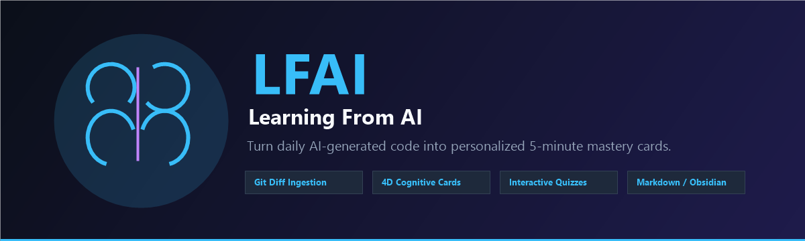

<p align="center">
  
</p>

<h1 align="center">🧠 LFAI</h1>

<p align="center">
  <b>Learning From AI</b>
</p>

<p align="center">
  Ship faster with AI. But actually learn from every line it writes.
</p>

<p align="center">
  <a href="https://marketplace.visualstudio.com/items?itemName=xixici.lfai">
    
  </a>
  <a href="https://github.com/xixici/learning-from-ai/releases">
    
  </a>
  <a href="https://github.com/xixici/learning-from-ai/actions/workflows/ci.yml">
    
  </a>
  <a href="https://github.com/xixici/learning-from-ai/blob/main/LICENSE">
    
  </a>
</p>

<p align="center">
  <a href="README.zh-CN.md">🇨🇳 中文文档</a> | <strong>🇺🇸 English</strong>
</p>

<p align="center">
  <a href="#-the-problem">The Problem</a> •
  <a href="#-features">Features</a> •
  <a href="#-quick-start">Quick Start</a> •
  <a href="#-how-it-works">How It Works</a> •
  <a href="#-configuration">Configuration</a> •
  <a href="#-contributing">Contributing</a> •
  <a href="./CHANGELOG.md">Changelog</a>
</p>

---

> **LFAI** = **L**earning **F**rom **AI**
>
> *Direct. Clear. Meaningful. Let AI write the boilerplate, but make sure YOU learn the craft.*

---

## The Problem

AI coding tools (GitHub Copilot, Cursor, Claude Code) have created a silent paradox:

> **You ship faster. But you learn slower.**

Every day, AI writes thousands of lines you accept without truly understanding — complex async patterns, architecture decisions, subtle edge guards. Three days later, you can't reproduce or debug them independently.

**LFAI closes that gap.** It automatically turns your daily AI-assisted code into a personalized 5-minute learning session — not generic tutorials, but knowledge extracted from *your own work*.

---

## ✨ Features

### 🔍 Automatic Daily Code Digest
Scans today's Git incremental changes, filters noise (lockfiles, build artifacts, formatting-only diffs), and surfaces the real learning signal.

### 🧩 4-Dimensional Learning Cards

| Card Type | What it captures |
|-----------|-----------------|
| 💡 **Syntax & Idioms** | Language features, advanced APIs, and patterns you used but might not fully grasp |
| 🏗️ **Architecture & Trade-offs** | Why the code is structured this way — decisions and their consequences |
| ⚠️ **Gotchas & Edge Cases** | Hidden guard clauses, race conditions, and silent risks in AI-generated code |
| ❓ **Active Recall Quiz** | Anki-style Q&A with hints and detailed explanations — so you verify you actually know it |

### 🖥️ Native VS Code Sidebar Panel

- Filter cards by category with one click
- Expand/collapse deep-dive explanations on demand
- Interactive quiz mode with reveal-on-demand answers
- Copy code snippets directly to clipboard

### 📝 Markdown Knowledge Base
Every daily digest auto-saves to `.lfai/daily/YYYY-MM-DD.md` — plain Markdown, compatible with **Obsidian**, **Logseq**, **Notion**, and any note-taking tool.

### 🤖 Zero-Config LLM Support
- **VS Code LM API** (default): Uses your existing GitHub Copilot subscription — no API key needed
- **Custom LLM**: DeepSeek, OpenAI, Claude, or any local Ollama endpoint

### ✂️ Selection-Based Instant Learning
Right-click any code selection → **"LFAI: Extract Learning from Selection"** — on-demand deep analysis of any snippet.

---

## 🚀 Quick Start

### Install from VS Marketplace *(Recommended)*
1. Open VS Code
2. Press `Ctrl+Shift+X`
3. Search for **"LFAI"**
4. Click **Install**

### Install from VSIX (Manual)
```bash
code --install-extension lfai-0.1.1.vsix
```

### First Use
1. Open any project with code changes
2. Press `Ctrl+Shift+P` → **`LFAI: Extract Today's Learnings`**
3. Check the sidebar (brain icon in Activity Bar) for today's cards
4. Find your Markdown notes in `.lfai/daily/`

---

## 🔧 How It Works

```
Your Code Changes (Git Diff / Selection)
         │
         ▼
   ┌─────────────────┐
   │  Data Collector  │  ← filters noise, builds context
   └────────┬────────┘
            │
            ▼
   ┌─────────────────┐
   │  LLM Engine     │  ← 4-dimensional extraction prompt
   │  (vscode.lm /   │
   │   Custom API)   │
   └────────┬────────┘
            │
            ▼
   ┌─────────────────┐
   │  Knowledge Base │  ← Markdown files + workspace cache
   └────────┬────────┘
            │
            ▼
   ┌─────────────────┐
   │  Sidebar UI     │  ← Interactive cards & quiz mode
   └─────────────────┘
```

---

## ⚙️ Configuration

Open VS Code Settings (`Ctrl+,`) and search for `lfai`:

| Setting | Default | Description |
|---------|---------|-------------|
| `lfai.llmProvider` | `vscode.lm` | LLM backend: `vscode.lm` (Copilot) or `custom` |
| `lfai.customApiBaseUrl` | `https://api.deepseek.com/v1` | Base URL for custom OpenAI-compatible API |
| `lfai.customApiKey` | `""` | API key for custom provider |
| `lfai.customModel` | `deepseek-chat` | Model name for custom provider |
| `lfai.notesDir` | `.lfai/daily` | Directory for Markdown notes (relative to workspace root) |

---

## 📋 Commands

| Command | Description |
|---------|-------------|
| `LFAI: Extract Today's Learnings` | Analyze today's git diff and generate learning cards |
| `LFAI: Extract Learning from Selection` | Deep-dive analysis of selected code snippet |
| `LFAI: Open Today's Note` | Open today's Markdown digest file |
| `LFAI: Refresh Sidebar` | Reload the sidebar panel |

---

## 🗺️ Roadmap

- [x] **v0.1** — Core extraction engine, sidebar UI, Markdown export
- [ ] **v0.2** — Spaced repetition (SM-2) scheduler, daily review reminders
- [ ] **v0.3** — Anki `.apkg` export, Obsidian plugin sync
- [ ] **v0.4** — Knowledge growth heatmap calendar
- [ ] **v0.5** — Team mode: share learning cards across a shared workspace

---

## 📈 Star History

<p align="center">
  <a href="https://star-history.com/#xixici/learning-from-ai&Date">
    <picture>
      <source media="(prefers-color-scheme: dark)" srcset="https://api.star-history.com/svg?repos=xixici/learning-from-ai&type=Date&theme=dark" />
      <source media="(prefers-color-scheme: light)" srcset="https://api.star-history.com/svg?repos=xixici/learning-from-ai&type=Date" />
      
    </picture>
  </a>
</p>

---

## 📄 License

MIT © [LFAI Community](https://github.com/xixici/learning-from-ai)
